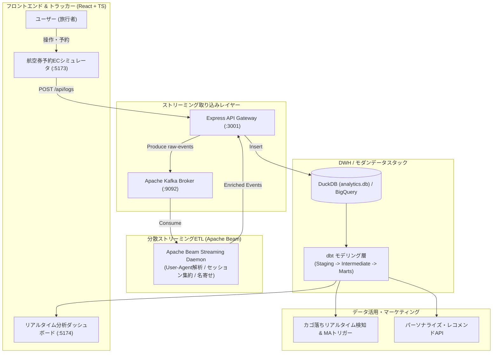

# Airline Real-Time Simulation & Modern Data Platform (Airline-MDP)

[](https://react.dev/)
[](https://www.typescriptlang.org/)
[](https://www.python.org/)
[](https://beam.apache.org/)
[](https://kafka.apache.org/)
[](https://duckdb.org/)
[](https://www.getdbt.com/)
[](https://cloud.google.com/)
[](https://www.docker.com/)

航空会社（Airline）のWeb予約ECサイトの業務ドメインを再現したフロントエンドと、**リアルタイム・イベント駆動型モダンデータプラットフォーム（Modern Data Stack on Cloud）**を融合させたエンドツーエンドのデータ基盤実装ポートフォリオです。

---

## 1. プロジェクト概要

### 解決するビジネス課題
航空券予約ECサイト等のWebサービスにおいて、従来の翌日バッチ分析では**「便検索や座席選択まで進んだが決済前に離脱した顧客（カゴ落ち）」**への対応が遅れ、莫大な機会損失が発生していました。
本システムは、ユーザーの閲覧・検索・予約行動ログをリアルタイムに収集・変換し、**イベント発生から5秒以内にDWHへ反映**。即時のファネル分析やカゴ落ち防止施策（マーケティングオートメーション）を実現します。

### 特徴
- **フルスタック＆エンドツーエンド**: 航空券予約ECフロント（React/TS）からメッセージング（Kafka/PubSub）、分散処理（Apache Beam）、DWH（DuckDB/BigQuery）、モデリング（dbt）、可視化ダッシュボードまで全レイヤーを完全実装。
- **ハイブリッド設計**: ローカル環境（Docker Compose）で完全再現可能であり、同時にGoogle Cloud（Cloud Run, Pub/Sub, Dataflow, BigQuery, Terraform）への本番移行に対応。
- **メダリオンアーキテクチャ**: Bronze（生ログ）→ Silver（クレンジング・Dim/Fact）→ Gold（分析マート）の段階的モデリングとdbt testによる品質保証。

---

## 2. システムアーキテクチャ



---

## 3. 主要コンポーネントと機能一覧

| コンポーネント | 技術スタック | 役割・機能 |
| :--- | :--- | :--- |
| **予約シミュレータ** | React, TypeScript, Vite, Tailwind | 路線検索、空席照会、シートマップ座席指定、決済、マイレージ会員管理 |
| **イベント収集Gateway** | Node.js, Express, KafkaJS | 行動ログの非同期受付（応答目標50ms以内）およびKafkaトピックへの配信 |
| **ストリーミングETL** | Python, Apache Beam, Docker | User-Agent解析（デバイス/ブラウザ判定）、タイムゾーン補正、会員番号の名寄せ |
| **DWH & モデリング** | DuckDB, Google BigQuery, dbt | メダリオン構造モデリング、dbt test自動検証、予約ファネルCVR分析 |
| **カゴ落ち検知 (MA)** | Express API, DuckDB SQL | 便・座席選択後に離脱したセッションをリアルタイム特定し、リマインド配信 |
| **レコメンドエンジン** | Express API, Rule/ML Hybrid | 検索履歴・マイル残高（特典航空券交換可能便）・人気度に応じた最適便推薦 |
| **分析ダッシュボード** | React, Recharts | リアルタイムアクティブ数、ファネル遷移率、路線別売上、デバイスシェア可視化 |

---

## 4. dbt データモデリング構造 (Medallion Architecture)

```
dbt_airline/models/
├── staging/                           # 【Silver】ソースデータの型変換・JSON展開
│   ├── stg_events.sql                 # 行動ログ (from_airport, seat_no等の展開)
│   ├── stg_flights.sql                # 運航便・路線マスタ
│   ├── stg_members.sql                # 会員ディメンション (ランク判定)
│   └── stg_bookings.sql               # 予約トランザクション
├── intermediate/                      # 【Silver】セッション集約ロジック
│   └── int_sessions.sql               # PV数、滞在時間、ステップ進捗フラグの集約
└── marts/                             # 【Gold】BI・施策用集計マート
    ├── mart_funnel_conversion.sql     # 訪問→検索→選択→座席→予約完了のCVR
    ├── mart_cart_abandonment.sql      # カゴ落ち離脱ユーザー抽出リスト
    ├── mart_route_performance.sql     # 路線別売上・搭乗率・平均客単価
    └── mart_member_segments.sql       # 会員LTV・搭乗回数セグメント
```

---

## 5. クイックスタート (How to Run)

### 前提条件
- Node.js (v18+)
- Python (3.10+)
- Docker & Docker Compose

### 1. リポジトリのクローンと依存関係インストール
```bash
git clone https://github.com/Anzai-Yuichiro/airline-modern-data-platform.git
cd airline-modern-data-platform

# フロントエンド & バックエンドの依存関係
npm install
npm run --prefix dashboard install

# Python仮想環境の準備 (Apache Beam)
python3 -m venv venv
source venv/bin/activate
pip install -r requirements.txt
```

### 2. インフラ（Kafka・Zookeeper）の起動
```bash
# Docker Compose で Kafka ブローカーを起動
make run-docker
```

### 3. 全アプリケーションの起動
```bash
# サーバー (Port 3001)、シミュレータ (Port 5173)、ダッシュボード (Port 5174) を同時起動
make run-all
```
- ✈️ **予約サイトシミュレータ**: [http://localhost:5173](http://localhost:5173)
- 📊 **分析ダッシュボード**: [http://localhost:5174](http://localhost:5174)
- ⚙️ **API Gateway**: [http://localhost:3001](http://localhost:3001)

### 4. トラフィックシミュレーションの実行
自動で様々なユーザー行動シナリオ（閲覧、フライト検索、座席選択、予約完了、カゴ落ち離脱）を投入します。
```bash
make simulate
```

### 5. dbt によるデータ変換と品質テスト
```bash
# dbt モデルのビルド
make dbt-run

# 一意性・外部キー制約等の自動テスト
make dbt-test
```

---

## 6. 詳細ドキュメント

本プロジェクトの設計書一式は [`docs/`](docs/) ディレクトリに収録されています。

- 📄 [システム要件定義書 (`docs/system_requirements_definition.md`)](docs/system_requirements_definition.md)
- 🏗️ [システムアーキテクチャ設計書 (`docs/system_architecture_design.md`)](docs/system_architecture_design.md)
- 📐 [データモデリング＆dbt設計書 (`docs/data_modeling_and_dbt_design.md`)](docs/data_modeling_and_dbt_design.md)
- 🎯 [MA機能＆レコメンド機能 仕様書 (`docs/advanced_features_spec.md`)](docs/advanced_features_spec.md)
- 💼 [ポートフォリオ解説＆アピール戦略書 (`docs/portfolio_presentation_guide.md`)](docs/portfolio_presentation_guide.md)

---

## 7. 作成者

- **エンジニア**: 安西 雄一郎 (Yuichiro Anzai)
- **専門領域**: Cloud Data Engineering / GCP (Google Cloud PCA) / Modern Data Stack
- **GitHub**: [@Anzai-Yuichiro](https://github.com/Anzai-Yuichiro)
