# 航空会社Web予約EC サイト構成図（サイトマップ）

航空券予約ECプラットフォームのWebシミュレーション（モックアップ開発）を目的とした構成図です。

## 全体構造図 (Mermaid)

```mermaid
graph TD
    Home[ホーム画面]

    %% 予約・航空券
    Home --> Res[予約・航空券]
    Res --> ResDom[国内線予約]
    Res --> ResInt[国際線予約]
    Res --> Tour[ダイナミックパッケージ<br/>航空券＋宿泊]
    Res --> Mng[予約確認・変更・取消]
    Res --> Status[運航状況]
    Res --> CheckIn[オンラインチェックイン]

    %% 運賃・時刻表
    Home --> FareTime[運賃・時刻表]
    FareTime --> Fare[運賃案内]
    FareTime --> Timetable[時刻表]
    FareTime --> SpecialFare[事前購入割引運賃]

    %% 機内サービス
    Home --> Service[機内サービス]
    Service --> Seat[空間設計・座席表]
    Service --> Amenity[お飲み物・アメニティ]
    Service --> Ent[機内エンターテインメント]
    Service --> Shop[機内販売・機内誌]

    %% 空港・チェックイン
    Home --> Airport[空港・搭乗ガイド]
    Airport --> AirportInfo[各就航地の空港案内]
    Airport --> BoardingGuide[ご搭乗手続き案内]
    Airport --> Baggage[手荷物のご案内<br/>機内持込・預け入れ]
    Airport --> Support[お手伝いが必要なお客様へ]

    %% マイレージ
    Home --> Mileage[AERO MILES<br/>マイレージ]
    Mileage --> Login[ログイン・新規入会]
    Mileage --> Earn[マイルを貯める]
    Mileage --> Use[マイルを使う]
    Mileage --> App[公式アプリ案内]

    %% インフォメーション
    Home --> Info[インフォメーション・サポート]
    Info --> News[重要なお知らせ・ニュース]
    Info --> Campaign[キャンペーン・特集]
    Info --> FAQ[よくある質問・お問い合わせ]
```

## ディレクトリ・ルーティング階層設計

フロントエンドフレームワーク（Next.jsやVite/Reactなど）で自作シミュレートする際の、ルーティング（URLパス）とコンポーネント階層の参考定義です。

*   **`/` (トップページ)**
    *   ヒーローエリア（キャンペーンバナースライダー）
    *   フライト検索コンポーネント（出発地、到着地、日付、人数）
    *   クイックアクセス（予約確認、運航状況、オンラインチェックイン）
    *   重要なお知らせエリア
*   **`/reservation/` (予約・購入)**
    *   `/reservation/search` - 空席照会結果・フライト選択画面
    *   `/reservation/passenger` - 搭乗者情報入力
    *   `/reservation/payment` - 支払い手続き
    *   `/reservation/change` - 予約確認・変更・取消（ログインまたは予約番号入力）
*   **`/tour/` (ダイナミックパッケージ)**
    *   `/tour/search` - 航空券＋ホテル検索画面
*   **`/flight-info/` (運航状況)**
    *   `/flight-info/today` - 本日の運航状況一覧
*   **`/checkin/` (空港・搭乗手続)**
    *   `/checkin/online` - オンラインチェックイン実行画面
    *   `/checkin/luggage` - 手荷物ルール案内
    *   `/checkin/airport/:id` - 各空港のアクセス・施設案内（例: `/checkin/airport/hnd`）
*   **`/fare/` & `/timetable/` (運賃・時刻表)**
    *   `/fare/list` - 各種運賃一覧
    *   `/timetable/:route` - 路線別時刻表
*   **`/inboard/` (機内サービス)**
    *   `/inboard/seat` - 座席仕様・シートマップ
    *   `/inboard/amenity` - ドリンクメニュー・アメニティ紹介
*   **`/mileage/` (マイレージプログラム)**
    *   `/mileage/login` - ログイン画面
    *   `/mileage/register` - 新規会員登録画面
    *   `/mileage/mypage` - マイル残高・会員証表示（マイページ）
*   **`/support/` (サポート)**
    *   `/support/faq` - よくある質問
    *   `/support/inquiry` - お問い合わせフォーム
