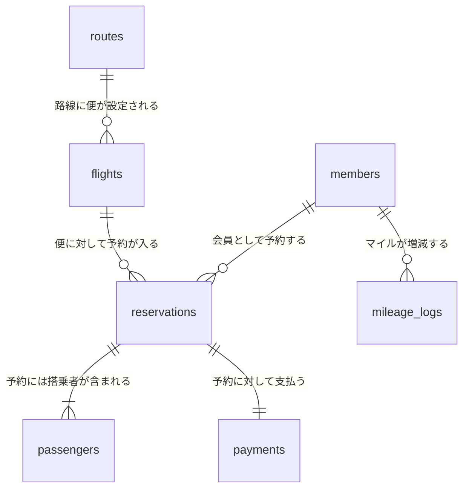

# スターフライヤー模擬システム データモデリング設計書

このドキュメントは、スターフライヤーのWebサイト機能やビジネスモデルをシステム化（データベース化）するために必要な**データの構造（データモデル）**を定義したものです。

---

## 1. データモデリングとは？（初心者向け解説）

**データモデリング**とは、現実のビジネス（スターフライヤーの運航やチケット予約など）を、コンピュータ（データベース）で扱えるように**「整理・設計」する作業**のことです。

身近な例でいうと、**「エクセルで管理するための『表（テーブル）』と『項目（カラム）』のレイアウトを決めること」**に似ています。

データモデリングでは、以下の3つの要素を整理します。

1.  **エンティティ（実体）**:
    *   管理したい「モノ」や「出来事」のことです。データベース上では1つの「テーブル（表）」になります。
    *   例：`会員 (Members)`、`運航便 (Flights)`、`予約 (Reservations)` など。
2.  **アトリビュート（属性）**:
    *   エンティティが持つ「詳細項目」のことです。テーブルの「列（カラム）」になります。
    *   例：会員テーブルにおける `氏名`、`メールアドレス`、`保有マイル数` など。
3.  **リレーションシップ（関係性）**:
    *   テーブル同士の「つながり」のことです。
    *   例：**1人の会員**は、**複数の予約**を持つ（1対多の関係）。

これらを正しく設計（モデリング）しておくことで、システムの開発時に「データの矛盾」が起きず、スムーズに予約管理やマイレージ計算ができるようになります。

---

## 2. データベースのテーブル設計（エンティティ定義）

スターフライヤーの主要機能をシミュレートするために必要なテーブル（エンティティ）の設計です。

### ① 会員テーブル (`members`)
STAR LINKマイレージ会員の情報を管理します。

| カラム名 (物理名) | 論理名 (日本語) | 型 | 説明・制約 |
| :--- | :--- | :--- | :--- |
| `member_id` | 会員ID | VARCHAR (主キー) | 会員番号（例: SFJ1234567） |
| `last_name_kanji` | 姓（漢字） | VARCHAR | 例: 星野 |
| `first_name_kanji`| 名（漢字） | VARCHAR | 例: 太郎 |
| `last_name_kana` | 姓（カナ） | VARCHAR | 例: ホシノ |
| `first_name_kana` | 名（カナ） | VARCHAR | 例: タロウ |
| `email` | メールアドレス | VARCHAR | ログインIDを兼ねる / 重複不可 |
| `password_hash` | パスワードハッシュ | VARCHAR | 暗号化されたパスワード |
| `current_miles` | 保有マイル | INTEGER | 現在使えるマイル残高 |
| `member_tier` | 会員ランク | VARCHAR | 一般 / ベガ(VEGA) / アルタイル(ALTAIR) |
| `created_at` | 登録日時 | DATETIME | |

### ② 路線テーブル (`routes`)
飛行機が飛ぶ「区間」を管理します。

| カラム名 (物理名) | 論理名 (日本語) | 型 | 説明・制約 |
| :--- | :--- | :--- | :--- |
| `route_id` | 路線ID | VARCHAR (主キー) | 例: HND-KKJ (羽田〜北九州) |
| `departure_airport`| 出発空港 | VARCHAR | 例: 羽田(HND) / 北九州(KKJ) |
| `arrival_airport` | 到着空港 | VARCHAR | |
| `base_price` | 基本運賃 | INTEGER | 運賃計算の基準となる価格 |

### ③ 運航便テーブル (`flights`)
「何月何日の何時に、どの路線をどの飛行機が飛ぶか」の実スケジュールです。

| カラム名 (物理名) | 論理名 (日本語) | 型 | 説明・制約 |
| :--- | :--- | :--- | :--- |
| `flight_id` | 便ID | VARCHAR (主キー) | 例: SFJ077 |
| `route_id` | 路線ID | VARCHAR (外部キー) | `routes` テーブルと連携 |
| `departure_time` | 出発日時 | DATETIME | 例: 2026/07/20 07:00 |
| `arrival_time` | 到着日時 | DATETIME | 例: 2026/07/20 08:40 |
| `aircraft_type` | 機材タイプ | VARCHAR | 例: Airbus A320 (全150席など) |

### ④ 予約テーブル (`reservations`)
顧客が行った予約の全体情報を管理します。

| カラム名 (物理名) | 論理名 (日本語) | 型 | 説明・制約 |
| :--- | :--- | :--- | :--- |
| `reservation_num` | 予約番号 | VARCHAR (主キー) | 英数字6桁の予約確認キー |
| `member_id` | 予約代表者ID | VARCHAR (外部キー) | 非会員予約の場合は NULL 可 |
| `flight_id` | 便ID | VARCHAR (外部キー) | `flights` テーブルと連携 |
| `status` | 予約状態 | VARCHAR | 予約済 / 決済完了 / キャンセル |
| `total_amount` | 合計金額 | INTEGER | 決済金額 |
| `reserved_at` | 予約日時 | DATETIME | |

### ⑤ 搭乗者テーブル (`passengers`)
1つの予約に紐づく、実際に飛行機に乗る人全員の情報を管理します（1つの予約で複数名乗る場合に対応）。

| カラム名 (物理名) | 論理名 (日本語) | 型 | 説明・制約 |
| :--- | :--- | :--- | :--- |
| `passenger_id` | 搭乗者ID | INTEGER (主キー) | 連番 |
| `reservation_num` | 予約番号 | VARCHAR (外部キー) | `reservations` テーブルと連携 |
| `last_name` | 姓（半角アルファベット）| VARCHAR | 例: HOSHINO |
| `first_name` | 名（半角アルファベット）| VARCHAR | 例: TARO |
| `seat_number` | 指定座席番号 | VARCHAR | 例: 12A（事前座席指定用） |
| `ticket_type` | 運賃種別 | VARCHAR | 大人 / 小児 / マイル特典など |

### ⑥ 決済・領収書テーブル (`payments`)
お金のやり取りと領収書発行データを管理します。

| カラム名 (物理名) | 論理名 (日本語) | 型 | 説明・制約 |
| :--- | :--- | :--- | :--- |
| `payment_id` | 決済ID | INTEGER (主キー) | 連番 |
| `reservation_num` | 予約番号 | VARCHAR (外部キー) | `reservations` テーブルと連携 |
| `payment_method` | 決済手段 | VARCHAR | クレジットカード / コンビニ決済 / マイル |
| `amount` | 決済金額 | INTEGER | |
| `paid_at` | 決済日時 | DATETIME | |
| `receipt_issued` | 領収書発行済フラグ | BOOLEAN | TRUE / FALSE |

### ⑦ マイル履歴テーブル (`mileage_logs`)
会員のマイルが「いつ、何の理由で、何マイル増減したか」の履歴です。

| カラム名 (物理名) | 論理名 (日本語) | 型 | 説明・制約 |
| :--- | :--- | :--- | :--- |
| `log_id` | 履歴ID | INTEGER (主キー) | 連番 |
| `member_id` | 会員ID | VARCHAR (外部キー) | `members` テーブルと連携 |
| `amount` | マイル増減値 | INTEGER | 獲得はプラス、利用はマイナス値 |
| `description` | 理由・詳細 | VARCHAR | 例: 「SFJ077便搭乗」「特典航空券交換」 |
| `action_date` | 発生日 | DATETIME | |

---

## 3. テーブルの関係性（ER図）

それぞれのデータがどのように繋がっているかを示す図（ER図）です。

## 4. このデータモデルを元にしたビジネスロジックの動作例

例えば、Webサイトで **「会員の星野さんがマイルを使って羽田→北九州の航空券を予約する」** という操作を行ったとき、システム（裏側のデータ）は以下のように動きます。

1.  **残高確認**: 会員テーブル (`members`) の `current_miles` が、必要なマイル数以上あるかチェック。
2.  **予約作成**: 予約テーブル (`reservations`) に新しいレコード（予約番号）を作成。
3.  **搭乗者追加**: 搭乗者テーブル (`passengers`) に星野さんの名前と指定した座席（例: `1A`）を登録。
4.  **決済記録**: 決済テーブル (`payments`) に `payment_method = 'マイル'` として記録。
5.  **マイル引き落とし**: マイル履歴テーブル (`mileage_logs`) に `-4500` などのレコードを追加し、同時に会員テーブル (`members`) の `current_miles` からその分を引き算する。

このように、データモデルを定義しておくことで、シミュレーションプログラムを作る際に「どのテーブルにデータを保存すればよいか」が明確になります。
