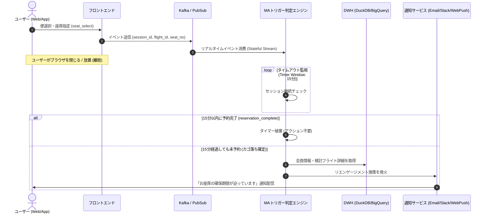
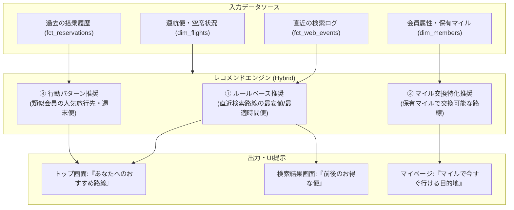

# 航空会社ECシミュレーション＆モダンデータ基盤 MA機能＆レコメンド機能 仕様書 (Advanced Features Spec)

- **システム名称**: Airline Real-Time Simulation & Modern Data Platform (Airline-MDP)
- **対象機能**: マーケティングオートメーション (MA) & パーソナライズド・レコメンド
- **作成者**: 安西 雄一郎 (Cloud & Data Engineer)
- **バージョン**: 1.1.0
- **最終更新日**: 2026-10-17

---

## 1. マーケティングオートメーション (MA) 機能設計

### 1.1 背景と課題
航空券ECサイトにおける予約ファネルにおいて、**「便検索や座席選択まで進んだものの、決済前に離脱するユーザー（カゴ落ちユーザー）」**は全体の60〜70%に達します。
カゴ落ち直後のユーザーは最も購入意欲が高いため、**「離脱から適切なタイミング（例: 15分後〜数時間以内）でリエンゲージメント施策を実施すること」**が売上拡大に直結します。

### 1.2 カゴ落ち検知＆トリガーアーキテクチャ



### 1.3 トリガーシナリオと配信コンテンツ

| シナリオ名 | 判定条件 | 配信チャネル | 配信メッセージ内容（例） |
| :--- | :--- | :--- | :--- |
| **即時カゴ落ちリマインド** | 座席指定完了後、15分間後続イベントなし | ブラウザ内ポップアップ / WebPush | 「選択中の羽田〜北九州便（77便 12A席）は残りわずかです。予約を再開しますか？」 |
| **会員向けメールリエンゲージメント** | ログイン会員が便検索・選択後に離脱し、2時間経過 | シミュレーションメール (HTML) | 「ご検討中のフライトに関するご案内（タイムセール運賃のご案内）」 |
| **価格変動・残席アラート** | 検索した便の残席が残り5席以下になった場合 | 会員マイページ通知 / LINE連携 | 「お気に入り路線の残席が残りわずかです」 |

---

## 2. フライトレコメンド機能設計

### 2.1 レコメンドアルゴリズムの段階的設計



### 2.2 推奨ロジック詳細

1. **直近コンテキスト推奨 (Context-Aware)**:
   - ユーザーが直近3日間に検索した「出発空港・到着空港」を抽出。
   - 同一路線における「最安値便（早割対象）」または「金曜夜・日曜夜の週末便」をトップ画面にピン留め表示。
2. **マイル消化アシスト推奨 (Mile-Driven)**:
   - 会員の `current_miles` を参照。
   - 例: 保有マイルが `5,000マイル` の場合、「羽田〜関西（必要マイル: 4,500マイル）」を「今すぐ特典航空券に交換できるフライト」としてハイライト。
3. **ビジネス/レジャー判定スコアリング**:
   - 搭乗曜日（平日朝・夕 = 出張傾向、金土日 = レジャー傾向）をスコアリングし、ビジネス客にはWi-Fiやシートピッチの快適性を訴求し、レジャー客には観光情報やレンタカー連携を提示。

### 2.3 レコメンドAPI仕様 (Express / Cloud Run)

#### エンドポイント: `GET /api/recommendations`
- **リクエストパラメータ**:
  - `member_number` (optional): 会員番号
  - `session_id` (required): セッションID
  - `limit` (default: 3): 取得件数
- **レスポンス形式 (JSON)**:
```json
{
  "recommendations": [
    {
      "flight_id": "AL077",
      "flight_number": "77便",
      "departure_code": "HND",
      "departure_name": "羽田",
      "arrival_code": "KKJ",
      "arrival_name": "北九州",
      "departure_time": "07:00",
      "arrival_time": "08:40",
      "base_price": 14500,
      "recommend_type": "LAST_SEARCHED",
      "recommend_badge": "直近検索した路線",
      "recommend_reason": "あなたが昨日検索した羽田〜北九州便の最安値プランです"
    },
    {
      "flight_id": "AL023",
      "flight_number": "23便",
      "departure_code": "HND",
      "departure_name": "羽田",
      "arrival_code": "KIX",
      "arrival_name": "関西",
      "departure_time": "14:15",
      "arrival_time": "15:35",
      "base_price": 9800,
      "recommend_type": "MILE_EXCHANGEABLE",
      "recommend_badge": "マイルで乗れる",
      "recommend_reason": "現在の保有マイル（6,200マイル）で特典航空券と交換可能です"
    }
  ]
}
```
