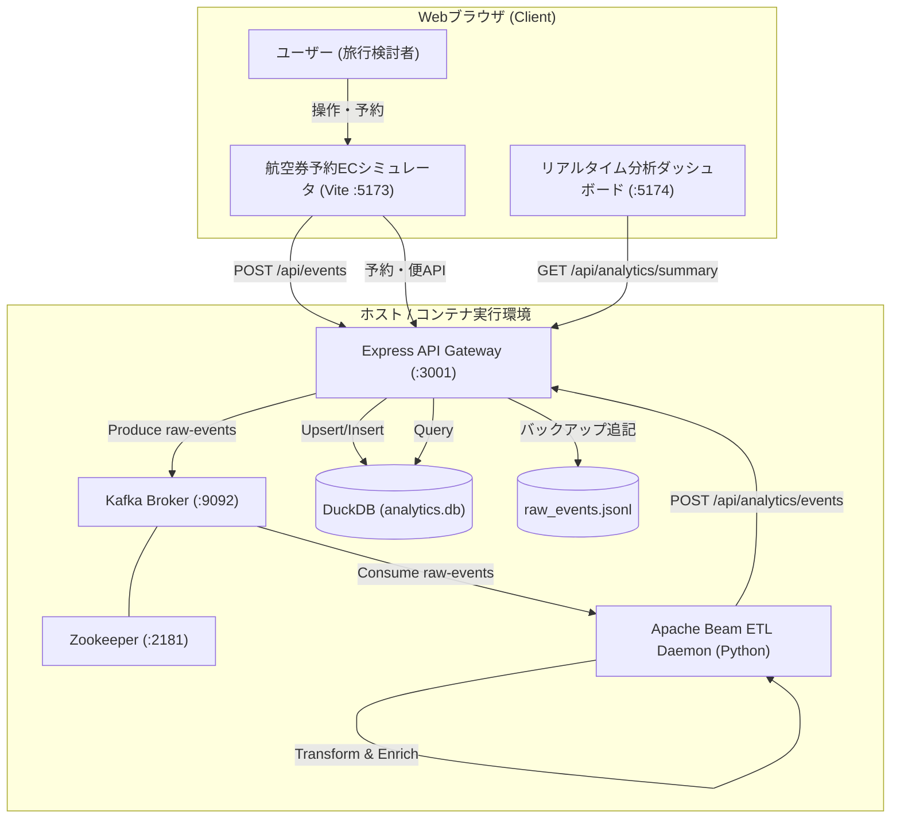
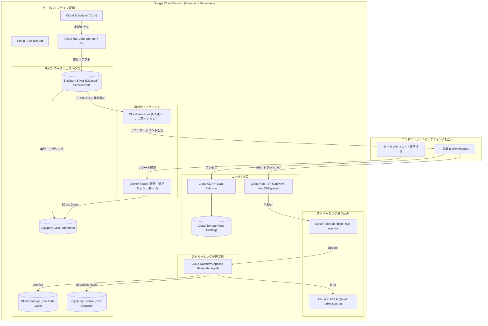

# 航空会社ECシミュレーション＆モダンデータ基盤 システムアーキテクチャ設計書 (Architecture Design)

- **システム名称**: Airline Real-Time Simulation & Modern Data Platform (Airline-MDP)
- **対象環境**: ローカルコンテナ環境（開発・検証） / Google Cloud（本番運用想定）
- **作成者**: 安西 雄一郎 (Cloud & Data Engineer)
- **バージョン**: 1.1.0
- **最終更新日**: 2026-10-17

---

## 1. 全体アーキテクチャ概要

本システムは、**「ローカルでの完全再現性」**と**「Google Cloud（エンタープライズ本番環境）へのシームレスな移行性」**を両立させた**ハイブリッド・アーキテクチャ**として設計されています。

共通のデータ処理コア（Apache Beamパイプラインコード、dbtデータモデリングSQL）を保持しながら、インフラレイヤーを環境に応じて差し替え可能な疎結合設計を採用しています。

### アーキテクチャ対比表

| レイヤー | ローカル開発・デモ環境 (Current) | Google Cloud プロダクション環境 (Target) |
| :--- | :--- | :--- |
| **フロントエンド** | React + TypeScript + Vite (`localhost:5173`) | Cloud Storage + Cloud CDN (静的ホスティング) |
| **API Gateway / App** | Node.js Express (`localhost:3001`) | Cloud Run (サーバーレス・オートスケール) |
| **メッセージブローカー** | Apache Kafka + Zookeeper (Docker Compose) | **Google Cloud Pub/Sub** (完全マネージドメッセージング) |
| **ストリーミングETL** | Apache Beam (DirectRunner on Python) | **Google Cloud Dataflow** (Beamマネージド実行環境) |
| **DWH / ストレージ** | DuckDB (`analytics.db`) + ローカルJSONL | **Google Cloud Storage (GCS) + BigQuery** |
| **データモデリング** | dbt-duckdb | **dbt-bigquery** |
| **分析ダッシュボード** | React Custom Dashboard (`localhost:5174`) | Looker Studio / BigQuery Studio |
| **インフラ管理** | Docker Compose | **Terraform (IaC)** |

---

## 2. システム構成図 (Mermaid Diagrams)

### 2.1 ローカル開発・検証環境構成

### 2.2 Google Cloud プロダクション環境構成

---

## 3. データ処理パイプラインの詳細設計

パイプラインは以下の4つのフェーズで構成されます。

### Phase 1: Ingestion（イベント収集とバッファリング）
1. **クライアントトラッカー**:
   - `navigator.sendBeacon` または `fetch` を使用し、ページ離脱時も取りこぼしなく非同期送信。
   - ペイロードには、クライアントタイムスタンプ、`session_id`、`event_id` (UUIDv4)、`event_name`、コンテキスト情報（URL, referrer, 画面解像度）が含まれる。
2. **API Gateway (Ingestion API)**:
   - 受信したリクエストをバリデーション後、即座にメッセージブローカー（Kafka / Pub/Sub）へ非同期パブリッシュ。
   - レスポンスは `202 Accepted` を返却し、クライアントへのレイテンシを極小化（目標: 30ms未満）。

### Phase 2: Streaming Transformation（Apache Beam）
Apache Beam パイプライン内で、以下の連続変換（Transforms）を実行：
1. **Deserialization & Validation**:
   - JSON文字列のパース、必須キーの存在チェック。
2. **User-Agent Parsing & Enrichment**:
   - 正規表現およびUser-Agentライブラリにより、`device_type` (PC / Mobile / Tablet)、`browser` (Chrome / Safari / Firefox / Edge / Other) を特定。
3. **Session Enrichment & Identity Resolution**:
   - セッション内で後からログイン（会員番号付与）が発生した場合、過去の匿名イベントに対しても会員番号を紐付けるアイデンティティ・レゾリューション処理。
4. **Time Windowing & Normalization**:
   - クライアント端末時刻のズレをサーバー受信時刻と突き合わせて正規化。

### Phase 3: Storage & DWH Layer（メダリオンアーキテクチャ）
- **Bronze (Raw)**:
  - 変更を加えない追記専用（Append-Only）ストレージ。
  - スキーマの予期せぬ変更やパイプライン障害時にも、過去データを100%再処理（Reprocessing）可能な設計。
- **Silver (Cleaned & Conformed)**:
  - 型変換、タイムゾーン統一、重複排除（Deduplication）が完了した中間テーブル。
- **Gold (Business Aggregates / Marts)**:
  - BIツールやMA機能が直接参照する、ディメンション・ファクト・マートテーブル群。

### Phase 4: Serving & Action Layer
- **分析クエリ**:
  - DuckDB（ローカル）または BigQuery（クラウド）に対し、ダッシュボードからSQLを発行。
- **リアルタイムアクション（MA）**:
  - 直近15分以内に「便検索または座席指定」を行い、「予約完了」していないセッションをウィンドウ集約で抽出し、通知キューへ投入。

---

## 4. Terraform によるインフラ自動化設計 (IaC)

Google Cloud環境は、すべてTerraformを用いてコード管理（IaC）可能な設計とします。

### 管理対象リソース一覧
1. **Artifact Registry**: Dockerコンテナイメージの保管
2. **Cloud Run**: API Gateway サービスのオートスケール構成（最小インスタンス0、最大10）
3. **Cloud Pub/Sub**:
   - Topic: `sfj-raw-events`
   - Subscription: `sfj-dataflow-sub`
   - Dead Letter Topic: `sfj-events-dlq`
4. **Cloud Storage**:
   - `sfj-data-lake-{project_id}`（生ログバックアップ）
   - `sfj-dataflow-temp-{project_id}`（Beam一時バッファ）
5. **BigQuery**:
   - Dataset: `sfj_bronze`, `sfj_silver`, `sfj_gold`
   - テーブルパーティショニング: `timestamp` カラムで日次パーティション
   - クラスタリング: `event_name`, `device_type`
6. **Cloud Dataflow**:
   - Apache Beam Python Streaming Job の定義
7. **IAM & Security**:
   - サービスアカウント（`sa-dataflow`, `sa-cloudrun`）と最小権限（`roles/pubsub.publisher`, `roles/bigquery.dataEditor` 等）のバインド
