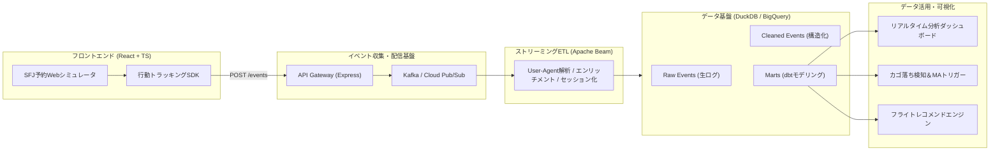

# スターフライヤー模擬システム 要件定義書 (System Requirements Definition)

- **システム名称**: StarFlyer Real-Time Simulation & Modern Data Platform (SFJ-MDP)
- **対象ドメイン**: 航空会社Web予約・マイレージサービス・リアルタイム行動分析・マーケティングオートメーション
- **作成者**: 安西 雄一郎 (Cloud & Data Engineer)
- **バージョン**: 1.0.0
- **最終更新日**: 2026-10-03

---

## 1. システム開発の背景とビジネス目的

### 1.1 背景
現代の航空会社やECサービスにおいて、顧客体験（CX）の向上とコンバージョン率（CVR）の最大化には、**「Web上のユーザー行動ログをリアルタイムに収集・統合し、即座にマーケティング施策や運航・価格調整にフィードバックする仕組み」**が不可欠です。
しかし、従来のバッチ処理主体のデータ基盤では、以下のような課題が存在していました：
1. **タイムラグによる機会損失**: カゴ落ち（便検索や座席選択後に離脱した顧客）へのアプローチが翌日以降になり、予約完了率が低下する。
2. **データのサイロ化**: 予約基幹DB（RDB）とWebアクセスログ（非構造化データ）が分断され、統合的なファネル分析やLTV算出に多大な工数がかかる。
3. **データエンジニアリングの属人化**: SQLクエリやデータ変換処理がスパゲッティ化し、データの品質・信頼性の担保が難しい。

### 1.2 ビジネス目的
本システムは、スターフライヤー（SFJ）の公式予約サイトを忠実に模擬したフロントエンドと、モダンデータスタック（Apache Beam, Kafka / Pub/Sub, DuckDB / BigQuery, dbt）を組み合わせることで、**「リアルタイム・イベント駆動型データプラットフォーム」**を構築・実証することを目的とします。

- **CVR（予約完了率）の向上**: 予約プロセスのファネル離脱ポイントをリアルタイムに可視化し、適切な離脱防止施策を打てる状態にする。
- **データ活用の即時化**: イベント発生から数秒〜数十秒以内に分析用DWHへ格納し、リアルタイムダッシュボードおよびMA（マーケティングオートメーション）へ連携する。
- **高信頼なデータモデリング**: dbtを用いたメダリオンアーキテクチャ（Bronze/Silver/Gold）により、品質テスト済みの分析マートを提供する。

---

## 2. システムスコープ

---

## 3. 業務要件 (Business Requirements)

| No | 業務項目 | 業務概要 | 期待成果 |
| :---: | :--- | :--- | :--- |
| **BR-01** | **フライト検索・空席照会** | 出発地・目的地・搭乗日・人数を指定して運航便の空席・運賃を照会する | ユーザーの検索傾向（人気路線・検索時期）をログとして蓄積 |
| **BR-02** | **座席指定・予約作成** | シートマップから希望座席を選択し、搭乗者情報を入力して予約を作成する | 座席の好みの把握、および予約途中離脱（カゴ落ち）の検出 |
| **BR-03** | **決済・領収書発行** | クレジットカードまたはマイル決済を行い、予約完了・領収書を発行する | 売上データの確定、決済失敗時の即時アラート |
| **BR-04** | **マイレージ管理** | 搭乗・予約に伴うマイル加算および特典交換によるマイル減算を管理する | 会員ランク別のLTV分析、マイレージ失効防止アプローチ |
| **BR-05** | **行動トラッキング** | ページビュー、クリック、滞在時間、スクロール、離脱イベントを計測する | 予約導線のUI/UXボトルネック特定 |
| **BR-06** | **カゴ落ち検知・MA連携** | 「座席指定まで進んだが15分以上予約完了していない」会員をリアルタイム検知 | リマインドメール・特別割引クーポンの配信シミュレーション |
| **BR-07** | **パーソナライズ推奨** | 会員の過去搭乗履歴・保有マイル・直近検索路線に応じた便を提案する | 単価向上（アップセル・クロスセル）および再訪率向上 |

---

## 4. 機能要件 (Functional Requirements)

### 4.1 フロントエンド（シミュレータ＆トラッカー）
- **FR-01: 予約サイトUI**:
  - トップページ（路線・日程検索ウィジェット）
  - 便選択画面（時間帯、運賃種別ごとの空席・価格表示）
  - 搭乗者情報入力・座席指定画面（A320機材シートマップ）
  - 決済画面（クレジットカード・マイル決済）
  - 予約完了・マイページ（予約履歴、保有マイル、会員ステータス表示）
- **FR-02: イベント自動収集SDK**:
  - `page_view`（URL, タイトル, リファラー）
  - `flight_search`（出発地, 到着地, 搭乗日, 人数）
  - `flight_select`（便ID, 運賃タイプ, 金額）
  - `seat_select`（座席番号, 窓側/通路側）
  - `reservation_complete`（予約番号, 決済手段, 合計金額）
  - `cart_abandonment`（離脱検知イベント）
  - セッションID（ブラウザストレージ管理）および会員番号（ログイン時）の自動付与

### 4.2 バックエンド・データ取り込み基盤
- **FR-03: API Gateway**:
  - `/api/events`（ログ収集エンドポイント、高速非同期受付）
  - `/api/flights`, `/api/members`, `/api/reservations`（基幹API）
- **FR-04: イベントストリーミング配信**:
  - Kafka / Cloud Pub/Sub による高スループット・耐障害バッファリング
  - トピック分割設計（`raw-events`, `processed-events`, `marketing-alerts`）

### 4.3 ストリーミングETL（Apache Beam）
- **FR-05: リアルタイム変換・エンリッチメント**:
  - User-Agentのパース（デバイス種別: PC/Mobile/Tablet、ブラウザ判定）
  - タイムスタンプのISO-8601正規化およびタイムゾーン補正
  - ログイン状態のセッションへの会員番号の自動バックフィル・名寄せ
  - 不正・欠損イベントのバリデーションおよびデッドレター（DLQ）ルーティング

### 4.4 DWH・モデリング（DuckDB / BigQuery + dbt）
- **FR-06: メダリオンデータモデリング**:
  - **Bronze**: イミュータブルな生イベントログ
  - **Silver**: クレンジング済イベント、正規化された予約・会員テーブル
  - **Gold**: 分析マート（ファネル分析マート、路線別収益マート、会員セグメントマート）
- **FR-07: データ品質テスト**:
  - dbt test による主キー一意性（unique）、非NULL制約（not_null）、外部キー参照整合性（relationships）の自動検証

### 4.5 可視化＆アドバンスド機能
- **FR-08: リアルタイム分析ダッシュボード**:
  - 現在のアクティブユーザー数、直近のイベントストリーム表示
  - 予約ファネル遷移率（検索 → 便選択 → 座席選択 → 決済完了）
  - 路線別・デバイス別・会員ランク別の売上・CVRチャート
- **FR-09: カゴ落ち検知＆MAトリガー**:
  - セッション内の最終イベントから一定時間経過をトリガーとする離脱検知
- **FR-10: レコメンドAPI**:
  - 会員の利用頻度・マイル残高に応じたおすすめフライトの推論API

---

## 5. 非機能要件 (Non-Functional Requirements)

| 区分 | 要件項目 | 目標値・仕様 |
| :--- | :--- | :--- |
| **性能・遅延** | イベント受信APIの応答速度 | 95パーセンタイルで **50ms以内** |
| | ストリーミングETL処理遅延 | イベント発生からDWH格納まで **5秒以内** |
| | ダッシュボード表示速度 | 初回ロード **1.5秒以内**、リアルタイム更新周期 **3秒** |
| **スケーラビリティ** | ピーク時トラフィック対応 | 秒間数千〜数万リクエストに対応可能な水平スケール構成（Beam/Dataflow, Pub/Sub） |
| **可用性・耐障害性** | メッセージ到達保証 | ネットワーク瞬断時もデータ欠損しない **At-least-once（再送・リトライ機構）** |
| | 単一障害点（SPOF）の排除 | 各コンテナ・クラウドサービスの冗長化 |
| **セキュリティ** | 個人情報保護 | パスワードのハッシュ化（Bcrypt）、決済情報（カード番号）の非保持化 |
| | 機密保持・アクセス制御 | IAMロールによる最小権限の付与、通信のTLS暗号化 |
| **保守性・IaC** | インフラのコード化 | Terraformによるインフラ再現性100%（GCP環境構築スクリプト） |
| | コンテナ化・再現性 | Docker / Docker Compose によるローカルワンコマンド立ち上げ |
